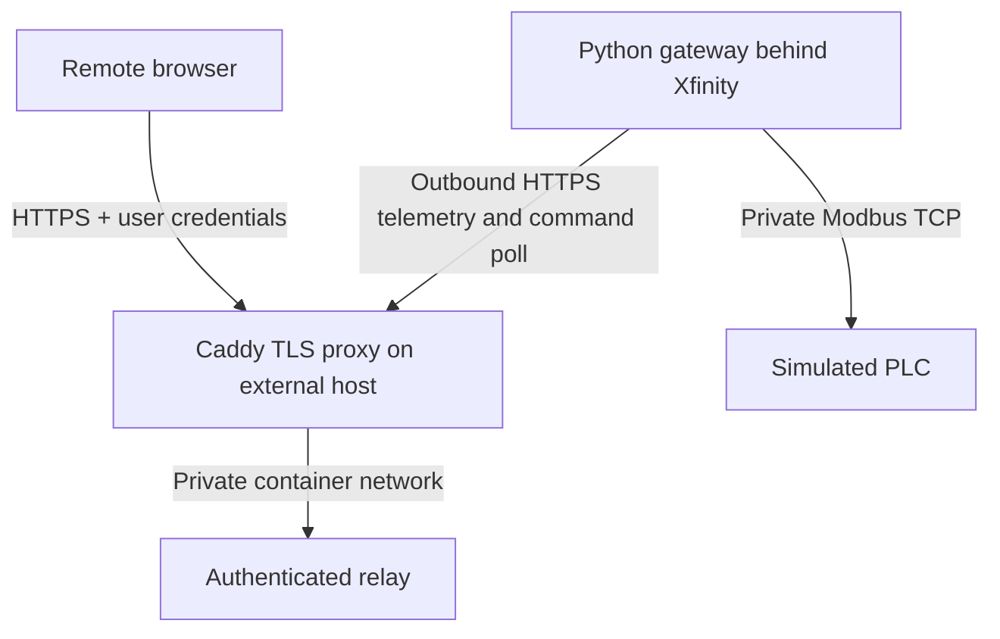

# PLC Access Lab

A runnable **single-gateway proof of concept** for remote PLC telemetry over an outbound HTTPS connection. Python/FastAPI relay, browser dashboard, Python gateway, real Modbus TCP simulator, Docker Compose, and automated tests. Starts in read-only mode with simulated data.

The home gateway never listens for internet connections. Remote users see a fixed telemetry schema; they cannot select hosts, browse PLC memory, upload logic, or open a protocol tunnel. This is not a Studio 5000/engineering workstation remote desktop replacement.

## Architecture



Only the external relay host publishes internet ports. On the home side there is **no router port forwarding, DMZ host, or exposed PLC port**. TLS ends at Caddy; Caddy-to-relay HTTP stays on a private internal Docker network. Modbus TCP is unencrypted and restricted to the local PLC network.

## Requirements

- Docker Engine or Docker Desktop with Compose v2.
- Python 3.12 for initialization and tests; OpenSSL for TLS tests.
- Windows 11: run these commands inside WSL2 Ubuntu with Docker Desktop WSL integration enabled. Keep the project in the WSL Linux filesystem for predictable file permissions. Native Windows is not the documented deployment path.

## 1. Run locally with a simulated PLC

From the repository root:

```bash
python3 -m venv .venv
source .venv/bin/activate
python -m pip install -r requirements-dev.txt
python scripts/init_secrets.py
docker compose up -d --build
```

The initializer prompts for separate `viewer` and `operator` passwords, each at least 14 characters. It creates salted scrypt hashes, a random gateway bearer token, and restrictive local files. It refuses to overwrite existing configuration. No passwords or tokens are committed.

Local Caddy creates an internal certificate authority. The `export_ca` one-shot service copies **only its public root certificate** to a volume readable by the gateway. The private CA key stays in Caddy's volume. On first start, allow a few seconds for certificates and telemetry.

Export the root to verify HTTPS from your workstation:

```bash
docker compose cp proxy:/data/caddy/pki/authorities/local/root.crt ./secrets/local-ca.crt
curl --cacert secrets/local-ca.crt --user viewer https://localhost:8443/api/status
```

`curl` prompts for the viewer password. Do not use `-k` or disable certificate verification. To open the dashboard at **https://localhost:8443**, import this root certificate into your browser's trusted certificate authorities. For Edge on Windows, import it into the current user's Trusted Root Certification Authorities, then restart the browser. Trust only the certificate from this installation and remove it after the lab. `localhost` is required for hostname validation.

Sign in at the browser's HTTP Basic prompt. Expect temperature around 24 °C, running status, setpoint 25 °C, and fresh telemetry within roughly 2–5 seconds. Basic credentials are cached by browsers; use a separate private browser session for each role and close that session to clear credentials. There is no application logout/session revocation endpoint.

```bash
docker compose ps
docker compose logs --tail=100 gateway relay
docker compose stop gateway
# After 10 seconds the dashboard must report stale/offline.
docker compose start gateway
docker compose down
```

Local HTTPS binds only to `127.0.0.1:8443`. The simulator, gateway, and relay publish no ports. `export_ca` exiting successfully is normal. `docker compose down` preserves the local CA; `down -v` destroys it and requires exporting/trusting a new certificate.

## 2. Optional simulator write demonstration

Keep simulation connected. Edit `.env`:

```dotenv
RELAY_ALLOW_WRITES=true
GATEWAY_READ_ONLY=false
```

Then run:

```bash
docker compose up -d --force-recreate relay gateway
```

Sign in as `operator`. The dashboard can write **only integer setpoints from 15 through 35 °C**, to holding-register PDU address 2. A `viewer` cannot write. A relay in read-only mode rejects writes; a gateway in read-only mode independently refuses them. The gateway host, unit ID, and register map cannot be changed from the web interface.

Commands expire after five seconds and are removed from the queue before delivery. They are never automatically retried. `delivered` means the outcome is unknown until the gateway acknowledges it; a connection loss can leave that state indefinitely. A new command is blocked until expiry plus a ten-second uncertainty window has passed. Check actual telemetry before another action. A Modbus acknowledgment means the register write was accepted, not that a physical process reached the target. Restore both defaults after the demo.

## 3. Remote deployment through an Xfinity home network

Use **two machines**: an internet-reachable Linux relay host with DNS, and a home Linux/WSL gateway behind Xfinity. A cloud VM and a domain are external prerequisites; this project does not create them.

### External relay host

1. Clone this project on the relay host and run `python3 scripts/init_secrets.py` there.
2. Add these entries to its `.env` (keep `RELAY_ALLOW_WRITES=false`):

   ```dotenv
   PUBLIC_DOMAIN=plc.example.com
   ACME_EMAIL=you@example.com
   ```

3. Point the domain's A record to the relay host's public IPv4 address. Only add AAAA if IPv6 routing/firewall is configured. Allow incoming TCP 80 and 443 on **that relay host** for HTTPS and ACME validation. Restrict SSH to administrative sources. Never publish port 8000 or 502/5020.
4. Start the server:

   ```bash
   docker compose -f compose.server.yaml up -d --build
   ```

5. Verify `https://plc.example.com/healthz` using normal certificate verification, then sign in at `https://plc.example.com`. Caddy obtains and renews a public certificate; preserve its data volume.

### Home gateway

1. Clone the same project behind Xfinity. Create `secrets/` with mode 700 and securely transfer **only** `gateway_token` from the relay host using an authenticated transfer such as SCP. Set the copied file to mode 600 and ownership to the local gateway account. Do not copy user password hashes or Caddy private keys to the home host. Do not run the initializer here: it would produce a different token.
2. Create `.env` with your local Linux UID/GID from `id -u` and `id -g`:

   ```dotenv
   LOCAL_UID=1000
   LOCAL_GID=1000
   RELAY_URL=https://plc.example.com
   GATEWAY_READ_ONLY=true
   ```

3. Start the simulator and gateway:

   ```bash
   docker compose -f compose.edge.yaml up -d --build
   docker compose -f compose.edge.yaml logs --tail=100 gateway
   ```

4. Leave Xfinity port forwarding empty for this project. Disable any existing PLC-related forward or DMZ-host assignment. Do not enable UPnP mappings for the gateway or PLC. Keep the gateway's host firewall denying unsolicited inbound connections on both IPv4 and IPv6. No bridge-mode change or static public home IP is required.
5. The gateway needs outbound DNS and TCP 443 to the relay; maintain accurate system time with NTP. If using a separate OT firewall, allow only the gateway-to-PLC TCP connection and the gateway's required internet egress. A home router alone is not an OT segmentation boundary.
6. From a phone on cellular data, open the relay's HTTPS URL and sign in. Confirm telemetry is fresh. Stop the home gateway and verify stale status. Confirm writes return 403 with default policies. Inspect your router's rules to ensure no PLC service was published.

Xfinity's port forwarding feature creates inbound reachability; **it is not needed for this outbound design**. Xfinity documentation: https://www.xfinity.com/support/articles/xfi-port-forwarding and https://www.xfinity.com/support/articles/xfi-advanced-settings.

## 4. Connecting an actual lab PLC

Complete simulator testing first. This adapter supports **Modbus TCP**, not native EtherNet/IP or Rockwell tag access. A Rockwell PLC needs an explicitly configured compatible Modbus endpoint or a separate vetted adapter. Do not assume every PLC supports this map.

| Zero-based PDU address | Example conventional label | Type and interpretation | Policy |
|---|---|---|---|
| 0 | 40001 | uint16 temperature, value / 10 °C | Read |
| 1 | 40002 | uint16 running, nonzero = true | Read |
| 2 | 40003 | uint16 setpoint, value / 10 °C | Read; optional bounded write |

For a known lab device, set `PLC_HOST`, `PLC_PORT` (usually 502), and `PLC_DEVICE_ID` in the home `.env`; review and change `plc_access/adapter.py` for the actual register map, data types, endianness, and scaling. Leave `GATEWAY_READ_ONLY=true`. Recreate the gateway and stop the unused simulator:

```bash
docker compose -f compose.edge.yaml up -d --force-recreate gateway
docker compose -f compose.edge.yaml stop simulator
```

The gateway's outbound Docker network permits LAN connections; enforce destination restrictions at the host/OT firewall. Permit TCP 502 from the gateway to the selected PLC only. Do not enable IP forwarding between physical OT and home interfaces. Read-only here is an application policy; physical firewall/device permissions provide additional enforcement where available. Physical safety interlocks remain in the PLC.

## Tests and CI

```bash
python -m pip install -r requirements-dev.txt
python -m pytest -q
docker compose config --quiet
```

The tests exercise authentication, role boundaries, CSRF header/CORS behavior, both write policies, input validation, command expiry and one-time delivery, stale data, rate limiting, real Modbus TCP reads/writes, TLS trust/hostname rejection, and the full gateway-to-TLS-relay path in separate processes. Test credentials are temporary. OpenSSL must be installed. GitHub Actions runs these tests, Compose validation/build, and a full simulated Compose smoke test.

## Security model and limits

- TLS certificate and hostname verification are mandatory; redirects and environment proxy inheritance are disabled in the gateway. Local CA trust is explicit; remote deployment uses system CA trust.
- Human authentication uses HTTP Basic over HTTPS with salted scrypt password hashes. Roles are `viewer` and `operator`. Gateway authentication uses a separate random bearer secret; it cannot access the human API. It is one gateway identity, not a multi-tenant service.
- No browser cookies or JWTs. Mutations require a custom action header; no CORS access is granted. CSP disallows inline scripts, framing, and external resources. Responses use no-store, HSTS, and nosniff headers.
- Twenty failed human credential checks per minute trigger a **global** one-minute failure budget. This is basic abuse protection and can be used for denial of service. Use a managed identity-aware access proxy with MFA and upstream rate limiting before broader exposure; this prototype does not provide MFA.
- Relay state, commands, and rate limits live in memory. Run **one Uvicorn worker and one relay instance**. Restarts discard telemetry and pending commands. There is no durable command history, HA, multi-site routing, or exactly-once execution guarantee.
- Audit logs include authenticated telemetry reads, denied login/write events, and command identity, requesting user, delivery, and result. Gateway logs include connectivity failures and write results. Raw credentials are not logged. Docker rotates Python service logs at 3 × 10 MB; external log retention and tamper protection are deployment responsibilities. Caddy access logging is disabled to avoid accidental authorization-header capture.
- Secrets are read from mounted files. To rotate the gateway credential, stop the gateway, replace the token on both hosts using a newly generated random value, and recreate relay/gateway containers. To revoke a user, remove its entry from `users.json` and recreate the relay; hashes are loaded at startup. Never commit `.env`, `secrets/`, or private keys.
- Dependency versions are pinned for this prototype; update and audit before sustained use. This is a lab proof of concept, not a certified industrial remote-access product.

## Files

`plc_access/relay.py` contains authentication, telemetry API and command queue; `gateway.py` is the outbound client; `adapter.py` enforces the fixed Modbus policy; `simulator.py` runs the simulator; `static/` holds the dashboard. Compose files separate local testing, external relay deployment, and home edge deployment.

Protocol and TLS references: https://pymodbus.readthedocs.io/en/v3.11.1/source/client.html and https://caddyserver.com/docs/automatic-https.
